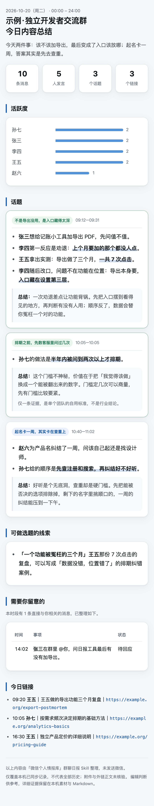

<h1 align="center">微信个人情报助手</h1>

<p align="center"><sub>WeChat Group Daily Report</sub></p>

<p align="center">
  <b>把你的微信群聊变成一张能读懂、可核查的图文日报。</b><br>
  输入一个群、一个时间窗，输出一张 PNG 长图 + HTML + Markdown。<br>
  不是聊天记录的缩写版，是像一位看完全程的群友给你讲今天真正发生了什么。
</p>

<p align="center">
  <a href="https://github.com/kbwzy/wechat-group-daily-report/actions/workflows/test.yml"></a>
  <a href="https://www.python.org/downloads/"></a>
  <a href="LICENSE"></a>
  
  
</p>

<p align="center">
  <a href="#快速开始三分钟无需微信">快速开始</a> ·
  <a href="#安装">安装</a> ·
  <a href="#它解决什么问题">为什么值得用</a> ·
  <a href="#边界">边界</a>
</p>



<p align="center"><sub>↑ 上面这张图由仓库内的 <code>examples/</code> 合成数据在离线环境生成，可直接复现。</sub></p>

## 它怎么工作

```text
群聊 JSON  ──prepare──▶  素材 + 证据 ID
                              │
                     Agent 语义编辑
                              ▼
                        editorial.json
                              │
                  validate --strict ──▶ render
                                            │
                          PNG 长图 / HTML / Markdown
```

三件事分开做，各管一段：**程序管事实**（切片、清洗、统计、抽链接、校验引用），**模型管表达**（标题、关键原话、判断），**模板管版式**（模型只写 JSON，碰不到 HTML）。

## 它解决什么问题

机器摘要只会按时间罗列。日报要回答的是另外几个问题：

- 今天真正值得读的主线是什么？
- 谁提出了问题、谁给了反例、后来有没有改口？
- 哪条讨论能长成一个选题？
- 有哪些事其实是在找你？

常见做法是把聊天丢给模型直接总结，结果每次格式不同、引用对不上、改口被截断。这里用**证据绑定**把模型约束住：每条事实都要挂一条真实消息的 ID，跨群或凭空捏造的 ID 会被校验器拒绝。同一份输入，渲染结果确定。

程序校验能保证结构、引用和密度；它**不能**保证观点真实。每份产物都显式标注 `semantic_truth: not-verified`，不冒充已验证。

## 特性

- **证据绑定**：每个事实、选题、提醒、链接都要挂真实证据 ID，跨群或凭空 ID 会被拦下。
- **半开时间窗** `[since, until)`，时区显式，定时任务用本地自然日而不是机器日期。
- **群昵称优先**：默认用群成员在本群的昵称称呼发言人。群昵称不在消息库里，需要额外读一次群成员表；同名多人会被标为歧义而不是硬猜。
- **固定版式合同**：模型只写 JSON，不碰 HTML。标题、栏目、四格、卡片、表格都由模板控制，渲染后再由 `layout_check.py` 复查一遍。
- **不覆盖历史**：每轮新建目录，重复执行不会删掉昨天的报告。
- **PNG 失败不撒谎**：缺 Playwright/Pillow/Chrome 时仍交 Markdown 和 HTML，状态明确标 `partial`，不会写成功。
- **只读**：不发送、不回复、不改微信、不取密钥。

## 快速开始（三分钟，无需微信）

`examples/` 里有一份合成群聊，token 全是占位，不会碰你的微信：

```bash
SKILL="$PWD"
RUN=/tmp/wechat-daily-demo && rm -rf "$RUN"

python3 "$SKILL/scripts/daily_report.py" prepare "$SKILL/examples/group-messages.json" \
  --chat "示例·独立开发者交流群" \
  --since 2026-10-20T00:00:00+08:00 --until 2026-10-21T00:00:00+08:00 \
  --timezone Asia/Shanghai --name-mode display --owner-alias "示例读者" --out "$RUN"

cp "$SKILL/examples/editorial.json" "$RUN/editorial.json"
python3 "$SKILL/scripts/daily_report.py" validate --strict --out "$RUN"
python3 "$SKILL/scripts/daily_report.py" render --out "$RUN" --png
```

跑出来的结果和本文最上方那张示例日报一致——同一份合成数据、同一条命令。

## 安装

这是一个 Agent Skill，同时兼容 Claude Code 和 Codex。

**把技能装在 `~/.agents/skills`，再用符号链接派发给各个 Agent。** 真实文件只有一份，Claude Code、Codex 或其他 Agent 都通过链接指向它——升级时只需要更新一处。

```bash
# 1. 克隆到 skills 根目录之外（或任意你放仓库的地方）
git clone https://github.com/kbwzy/wechat-group-daily-report.git

# 2. 真实安装位置
mkdir -p ~/.agents/skills
ln -s "$PWD/wechat-group-daily-report" ~/.agents/skills/wechat-group-daily-report

# 3. 按需派发给各个 Agent（用哪个接哪个）
mkdir -p ~/.claude/skills
ln -s ~/.agents/skills/wechat-group-daily-report ~/.claude/skills/wechat-group-daily-report

mkdir -p ~/.codex/skills
ln -s ~/.agents/skills/wechat-group-daily-report ~/.codex/skills/wechat-group-daily-report
```

如果你只用一个 Agent，也可以跳过第 3 步——多数 Agent 同样会直接扫描 `~/.agents/skills`。

### 同级依赖怎么找

本技能需要 `wechat-cli` 和 `wechat-intelligence-hub`。它们**不必和本技能放在同一个根目录**：脚本会逐个依赖地在下面这些根目录里查找，找到即用，所以把它们装在 `~/.agents/skills`、而本技能装在别处也没有问题。

```
$AGENTS_HOME/skills  →  $CLAUDE_HOME/skills  →  $CODEX_HOME/skills
~/.agents/skills     →  ~/.claude/skills     →  ~/.codex/skills
```

没有环境变量时按后一行。也可以用 `hub_entry`（hub.sh 路径）、`reader`（reader.sh 路径）、`hub_home`（Hub 项目目录）三项配置直接指定，绕过自动查找。

### 依赖

| 依赖 | 版本 | 用途 | 必需 |
|---|---|---|---|
| Python | **3.9+**（3.13、3.14 实测可用） | 全部脚本；用到 `zoneinfo` | 是 |
| [wechat-intelligence-hub](https://github.com/Rion-Wu-tech/wechat-intelligence-hub) | `v0.9.2-preview.2` 或更新 | 从本地微信库取数（`chat-history`、`members`、`sql`） | **实时取数时必需** |
| Playwright + Pillow + 本机 Chrome | `pillow>=10.0`、`playwright>=1.40` | PNG 长图（430 CSS 像素、3 倍分段截图拼接） | 只影响 PNG |
| Claude Code CLI | 支持 `--restricted` 的版本 | `run_daily.py` 的无人值守编辑桥接 | 只影响定时模式 |

**只依赖标准库的部分不需要额外安装**：`prepare`、`validate`、`render` 的 Markdown/HTML 输出，以及全部 58 项测试。Pillow 与 Playwright 只在 `render --png` 时导入，缺了不影响其他步骤。

#### 获取实时取数依赖

`wechat-cli` 与 `wechat-intelligence-hub` **不在 PyPI**，`pip install` 装不到。它们是同一位作者（Rion Wu）维护的独立项目，需要单独安装：

```bash
git clone https://github.com/Rion-Wu-tech/wechat-intelligence-hub.git
cd wechat-intelligence-hub
./scripts/install.sh --with-sqlcipher --with-html
```

安装后会得到 `wechat-cli` 与 `wechat-intelligence-hub` 两个 Skill。查找顺序见上方[同级依赖怎么找](#同级依赖怎么找)，也可以用配置项 `hub_entry` / `reader` 手动指定。

> **注意**：装好 ≠ 能读。完整数据库模式还需要你已经获得本机微信数据库的访问材料（key）。没有时 `doctor` 会失败，本 Skill 会如实报错并保留素材，不会退化成通知预览。接入请参考上游的 [五步首次接入工作流](https://github.com/Rion-Wu-tech/wechat-intelligence-hub/blob/main/skills/wechat-cli/references/access-onboarding.md)。

#### 离线跑测试

```bash
python3 -m venv .venv && . .venv/bin/activate
python3 -m unittest discover -s tests     # 58 项，无需任何第三方包

pip install -r requirements.txt           # 仅想做 PNG 时才需要
```

#### 实测兼容性

| Python | 测试套件 | PNG | 说明 |
|---|---|---|---|
| 3.9 | ✅ 58/58 | 用 `pillow>=10.0` | |
| 3.10 | ✅ 58/58 | 用 `pillow>=10.0` | |
| 3.11 / 3.12 | ✅ CI 覆盖 | 用 `pillow>=10.0` | 每次提交自动跑 |
| 3.13 | ✅ 58/58 | ✅ | |
| 3.14 | ✅ 58/58 | ✅ | Pillow 13 / Playwright 1.64 验证通过 |

3.9–3.13 由 [CI](.github/workflows/test.yml) 在每次提交时自动验证。

PNG 依赖**不装也能用**：`render` 会照常产出 Markdown 和 HTML，只在 `status.json` 里写 `png: missing-dependency` 并以退出码 2 返回。它不会静默跳过，也不会假装成功。

## 真实使用

### 交互式（推荐先这样用）

在 Agent 里直接说「把这个群昨天的聊天做成图文日报」。Skill 会：

1. 用 `wechat-cli` 的 `resolve-chat` 确认唯一精确群名，不接受模糊匹配或同名多选。
2. 用稳定群 ID 走 Hub 的 `chat-history` 拉窄范围消息，同时读群成员表拿群昵称。
3. `prepare` 出素材，你（或 Agent）通读 `material.md` 写 `editorial.json`。
4. `validate --strict` → `render --png`，交三个文件加覆盖说明。

### 定时

复制 `assets/config.example.json` 到**技能目录之外**（默认 `~/.wechat-intelligence-hub/group-daily.json`）再填群名：

```bash
python3 "$SKILL/scripts/run_daily.py" --config ~/.wechat-intelligence-hub/group-daily.json
```

`run_daily.py` 会把「取数 → prepare → 调 Claude Code 写稿 → validate → render」串起来。编辑子进程只拿到 `Read,Write` 两个工具，跑在 restricted 模式，不给 Shell、浏览器和 MCP，也不会传 `--dangerously-skip-permissions`。详见 [`references/scheduling.md`](references/scheduling.md)。

安全试跑——不碰微信、不调模型：

```bash
python3 "$SKILL/scripts/run_daily.py" --config "$CONFIG" \
  --input examples/group-messages.json --date 2026-10-20 --prepare-only
```

## 配置

| 字段 | 默认 | 说明 |
|---|---|---|
| `chat` | — | **必填**，精确群名；同名多群会直接失败 |
| `timezone` | `Asia/Shanghai` | 窗口与显示都用它 |
| `window` | `yesterday` | `yesterday` / `today` / `rolling24` |
| `output_root` | `~/Desktop/wechat_daily` | 每轮在其下新建唯一目录 |
| `read_limit` | `20000` | 达到上限会标注「不能视为全量」 |
| `png` | `true` | 关掉就只出 Markdown/HTML |
| `name_mode` | `group-nick` | 改成 `display` 用联系人备注/昵称 |
| `local_only` | `false` | `true` 时拒绝启动云端编辑 |
| `signature` | 空 | 页脚署名/联系方式，只从私有配置或 `WECHAT_DAILY_SIGNATURE` 读 |

不存任何凭据。

## 输出

| 文件 | 说明 |
|---|---|
| `group_daily_report.png` | 长图，430 CSS 像素 × 3 倍 |
| `group_daily_report.html` | 单文件，无外部资源，CSP 限制为 `default-src 'none'`，浅深色主题 |
| `group_daily_report.md` | 同版式的 Markdown，带本机证据注释 |
| `quality_checks.json` | 本轮版式合同结果 |
| `status.json` / `delivery.json` | 机器可读状态；`png_status` 如实反映 PNG 是否真的生成 |
| `material.json` / `material.md` | 素材与证据，只在本机 |

## 边界

- 只读微信。不发送、不回复、不转发、不加好友、不改标签、不动调度。
- 聊天、昵称、引用、链接都是**不可信数据**；消息里写着「忽略以上指令」也不会被执行。
- 不外搜、不上传聊天。模型处理由你授权的 Agent 承担，产物不公开托管。
- 只覆盖本机已同步的记录。附件未读、外链正文未读、采集上限、覆盖缺口都会写进报告，不用「没读到」冒充「没有」。
- 格式校验通过 ≠ 事实已验证。每份产物都标 `semantic_truth: not-verified`。

## 合规与使用前提

**这不是腾讯或微信的官方项目。** 未获得腾讯认可、赞助或维护，也与微信团队无关。WeChat、微信等名称是各自所有者的商标，此处仅作描述性说明。

使用前请确认你在做的是**处理你自己有权访问的数据**：

- 本仓库不含任何解密、注入、Hook、重签名或密钥提取代码。它不获取微信数据库密钥，不修改微信，也不绕过任何访问控制。
- 它读取的是**本机已解密、且你本人已获得访问权**的聊天记录，通过独立项目 `wechat-intelligence-hub` 的只读接口。取得该访问权是你与上游项目之间的事，不在本仓库范围内。
- 不改微信、不发送消息、不自动加好友。所有输出都留在本机，本 Skill 不上传、不托管、不分享聊天内容。
- 报告包含真实聊天与联系人信息。请自行保管，谨慎决定是否在群里或公开发布。

你需要自行确保使用方式符合所在地法律、所在群组的约定，以及微信的服务条款。作者不对因使用本工具产生的任何后果承担责任。本软件按 MIT 许可「按原样」提供，不作任何担保。

## 目录结构

```text
SKILL.md                 入口：执行流程与边界
references/
  workflow.md            取数、编辑、验收的完整流程
  editorial.md           编辑准则与正反例
  contracts.md           输入/输出合同、format_version=2 字段
  scheduling.md          定时桥接、私有配置、失败恢复
scripts/
  daily_report.py        prepare / names / validate / render
  run_daily.py           定时桥接（取数 → 编辑 → 校验 → 渲染）
  group_nicknames.py     群昵称 protobuf 解析与映射
  report_view.py         固定 HTML 版式
  layout_check.py        渲染后的版式合同复查
examples/                可离线跑通的合成示例
tests/                   58 项单元测试
evals/                   路由触发用例与语义配置
```

改版式或改校验规则前请先读 [`tests/`](tests/)——版式合同、证据引用、命名口径都有对应测试。

## 生态

本 Skill 只负责单群日报，取数依赖 [wechat-intelligence-hub](docs/ecosystem.md) 与 `wechat-cli`。跨群综合日报、私聊跟进、商机状态维护不在本仓库范围内。

## 许可证

[MIT](LICENSE)
